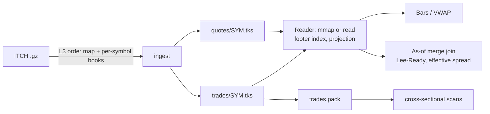

# tickstore

A columnar, compressed tick database in Go. It stores trades and top-of-book quotes per symbol,
with Gorilla-style delta-of-delta timestamps, delta/zigzag fixed-point prices and a zstd stage. It
supports time-range scans with block indexes, OHLCV/VWAP resampling, and as-of joins of trades to
the prevailing quote (Lee-Ready classification, effective spread). It ingests a full day of NASDAQ
ITCH and is benchmarked against Parquet + DuckDB on the same data, with value-for-value result
checks.

[](https://github.com/eshaan2418/tickstore/actions/workflows/ci.yml)


> Educational/research project. Not investment advice. No live trading.

## Headline numbers

NASDAQ ITCH 2019-01-30, giving 9,580,917 trades (all 7,538 symbols) and 10,267,547 top-of-book
quotes (20 liquid symbols). Apple M5 Pro. Raw output:
[`bench/results/20261102-024318/`](bench/results/20261102-024318/SUMMARY.md).

| | tickstore | Parquet (zstd) + DuckDB 2.0 |
|---|---|---|
| Storage, trades + quotes | **114.5 MB** (6.3× vs raw int64 columns) | 118.5 MB (6.1×) |
| One symbol, 1-hour range count | **0.88 ms** | 5.14 ms |
| One symbol, 1-minute OHLCV + VWAP, full session | **4.95 ms** | 13.38 ms |
| As-of join trades → quotes (AAPL, 95,735 trades) | 33.7 ms | 36.9 ms |
| Whole-market VWAP per symbol (7,486 symbols) | 168.8 ms (pack file, 8 workers) | **38.4 ms** |
| Encode + write all trades from memory (no fsync) | 4.1M rows/s | **12.3M rows/s** (pyarrow, one file) |
| Results agree with DuckDB (counts, volumes, effective spread, as-of checksum) | **all queries: yes** | |

Lee-Ready versus the feed's true aggressor (from ITCH): **88.4%** agreement on AAPL.

## Demo

`make demo` (`research/results/demo_output.txt`):

```
== AAPL 2019-01-30, first five 1-minute bars (Nasdaq prints)
  09:30  O 163.24  H 163.33  L 162.49  C 162.59  vol  172,445  vwap 162.8190
  09:31  O 162.59  H 162.65  L 161.80  C 162.00  vol  129,694  vwap 162.1255
  09:32  O 162.00  H 162.69  L 161.93  C 162.43  vol  107,101  vwap 162.4067
  09:33  O 162.40  H 162.54  L 161.80  C 161.82  vol   86,749  vwap 162.0681
  09:34  O 161.83  H 161.88  L 161.66  C 161.68  vol  115,351  vwap 161.7437
== AAPL trades as-of joined to the prevailing quote (regular session)
  trades 95,735  Lee-Ready buys 49,421  sells 46,314  agreement with ITCH aggressor 88.4%  effective spread 0.91 bps
```

## Why it matters

Every quant desk's research stack starts with a tick store: kdb+ at most banks and HFT firms,
plus ArcticDB, QuestDB and Parquet data lakes elsewhere. Research questions translate into a few
access patterns:
- one symbol over a time range (bars, microstructure studies);
- trades joined to the prevailing quote (execution quality, trade classification, markouts);
- cross-sections (market-wide VWAP, factor snapshots).

Storage cost and query latency for these patterns decide how fast researchers can iterate. Ticks
compress unusually well, because timestamps are near-regular, prices move by single ticks and
sizes are round lots, so the encoding choices matter.

## Highlights

- **Type-aware encodings plus a zstd stage:**
  - delta-of-delta timestamps with Gorilla buckets;
  - delta + zigzag + varint fixed-point prices and sizes;
  - an optional zstd pass per column chunk, kept only when smaller (3.6× → 6.3×);
  - Gorilla XOR float encoding is implemented and tested.
- **Block index and projection pushdown.** Footer time ranges skip blocks, and queries decode only
  the columns they touch.
- **As-of join and Lee-Ready**, measured against ground truth: the ITCH feed says which side was
  the aggressor, so classification accuracy is observable rather than assumed.
- **An independent checker.** DuckDB computes the same four queries on Parquet, and every result
  matches exactly.
- **Profiling-driven fixes for cross-sectional scans:**
  - reading small files instead of mapping them took the scan from 2,168 to 870 ms;
  - a pack file plus workers took it to 169 ms;
  - DuckDB still wins this query by 4.4×, which is documented, not hidden.
- **Crash-safe and fuzzed:** atomic temp-and-rename publishing, a CRC32-C per block, and fuzzed
  encoders and reader.

## Quick start

```bash
make build test
make data                                  # ingest the ITCH sample (needs itchbook's 'make data' file)
bin/tickstore bars  -dir DB -symbol MSFT -interval 5m
bin/tickstore asof  -dir DB -symbol AAPL
bin/tickstore vwap  -dir DB                # top 20 symbols by volume, regular session
bin/tickstore pack  -dir DB                # pack partitions for cross-sectional scans
make bench                                 # tickstore vs Parquet + DuckDB (needs uv for the Python baseline)
```

## Architecture



Format, encodings and query algorithms: [`docs/DESIGN.md`](docs/DESIGN.md). Interview Q&A:
[`docs/DEEP_DIVE.md`](docs/DEEP_DIVE.md).

## Correctness

| test | checks |
|---|---|
| encoders | exact round trip for timestamps (incl. int64 extremes), delta ints, floats (incl. NaN, ±Inf, -0); fuzzed encode/decode and decoding of arbitrary bytes |
| store | range scans equal brute force on 200 random windows (raw and zstd); block CRC detects corruption; truncated files rejected; atomic publish; fuzzed reader |
| query | bars (OHLCV, VWAP, counts) and as-of join (matches, checksum, classification) equal brute force |
| end to end | the four benchmark queries agree exactly with DuckDB on Parquet |

## Performance notes

- **Per-symbol queries win** because a symbol-day is one small file: no symbol filter, no
  row-group pruning, and only the needed columns decoded.
- **Cross-sectional queries lose** because the layout is per symbol. A profile showed 64% of the
  time in open/mmap syscalls across 7,538 files. Reading small files and adding pack files cut it
  12.8×, and DuckDB's single sorted file is still 4.4× faster here. A production design would keep
  both layouts, or a day file sorted by (symbol, ts) with a symbol index.
- **Writes:** encode + write without fsync runs at 4.1M rows/s, against pyarrow's 12.3M rows/s
  (C++). With an fsync per partition it is 0.3M rows/s, because `F_FULLFSYNC` on 7,538 files
  dominates.
- **Ingest** of the full ITCH day (368M messages) takes 282 s. It is bounded by the Go L3 order
  map and gzip, not the storage writer.
- **Noisy machine.** The laptop was shared with an unrelated heavy workload during these runs
  (load averages in `machine.txt`).

## Design decisions and trade-offs

| decision | chosen | rejected, and why |
|---|---|---|
| prices | fixed-point int64 + delta | float64 + XOR (inexact aggregates; worse ratio for tick-quantised prices) |
| partitioning | per symbol-day (+ pack for cross-sections) | one day file (slower per-symbol access; Parquet already covers it) |
| compression | type-aware encoding + zstd per chunk | zstd alone (misses trend structure) / encoding alone (misses repetition) |
| reads | mmap large files, read small ones | always mmap (syscall-bound at 7.5k files) |
| durability | temp + fsync + rename | in-place writes (torn files on crash) |

## Limitations and roadmap

- Single day, single writer; no catalog or SQL layer.
- Streaming ingest (open segment + sealed blocks), multi-day partitions.
- Ingest directly from [marketmux](https://github.com/eshaan2418/marketmux) captures (crypto
  BBO/trades).
- Vectorised decode (SIMD varint, bit-unpacking) and shared zstd dictionaries for tiny
  partitions.
- A symbol-sorted day layout for cross-sectional queries.

## Related projects

- [itchbook](https://github.com/eshaan2418/itchbook): the ITCH feed handler (C++), source of the
  data.
- [queuesim](https://github.com/eshaan2418/queuesim): backtester on the same ITCH day.
- [marketmux](https://github.com/eshaan2418/marketmux): live crypto market data, future ingest
  source.

## License

MIT. See [LICENSE](LICENSE). Educational/research project. Not investment advice. No live trading.
NASDAQ ITCH sample data © Nasdaq, Inc.; not redistributed.
